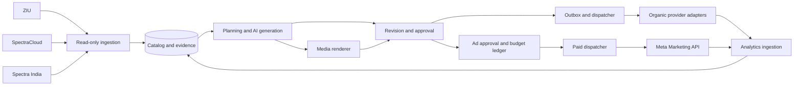

# Architecture, data and API design (proposed)
## 1. System boundaries
Use a modular monolith: Next.js UI, FastAPI API, PostgreSQL, optional pgvector, Redis/Celery workers and a scheduler, private object storage and approved provider adapters. Remotion/FFmpeg worker for video; segregate media rendering and crawling resources. No direct browser-to-provider secrets. Separate staging credentials and synthetic fixtures. Confirm actual stack and versions in ADRs rather than installing automatically.

Trust boundaries: public websites/untrusted inputs; internal user/API; workers; secrets vault; AI and social external providers. AI sees approved scoped evidence and produces structured proposals, never credentials or arbitrary network/tool calls. Deterministic services own state, budget and side effects.
## 2. Module responsibilities
Identity/RBAC; source connectors and ingestion; catalog and provenance; asset library; retrieval; strategy; content versions; media render; approvals; calendar; publishing; advertising; cost ledger; analytics; notifications; admin/audit. Separate provider interfaces for fetch, auth, capability discovery, publish, remote lookup, status, pause and metric ingestion. Implement provider-specific calls only after verification of current docs and permissions. Prefer interface contracts over vendor assumptions.
## 3. Logical schema
Every business row includes org_id, created_at and updated_at where meaningful; UUID keys, composite scoped foreign keys, explicit uniqueness and authorization. Store UTC timestamps; money as integer minor units + ISO currency; no floating point amounts. Adopt RLS as defense in depth if validated with pooled connections and worker context.
| Entity | Essential fields / constraints |
|---|---|
| organizations, users, memberships | org name/status; user identity; org/user unique, role and active flag |
| sources, sync_runs, source_documents | source URL/type/config; run state/checkpoint; canonical URL, content hash, retrieval time, visibility, version |
| catalog_items, item_versions, item_sources | type, canonical SKU, title/status; facts JSON typed schema, validity, lineage; scoped source external ID unique |
| evidence_chunks | document version, offsets/text/hash, visibility, embedding model/version; scoped retrieval |
| assets, brand_profiles | object key, hash, rights, status, size/mime, alt text; logo/palette/template revision |
| plans, plan_items, campaigns | period, targets, quotas, source goal, score, rationale, approval and due date |
| content_items, content_revisions, variants | item kind/source, revision immutable, content hash, platform copy/media, evidence refs, destination, sensitivity |
| claim_evidence | revision/claim ID, item version/document version, quote or span and validation status |
| generation_jobs, usage_events | task/idempotency key, provider/model, attempts, token/seconds/units, cost estimate/actual, status |
| approvals, approval_policies | action, revision/config hash, actor, decision, limits, expiry, revocation, policy version |
| social_connections | provider, external identity/account, scopes, token vault reference, expiry, capability snapshot, status |
| publications, dispatch_attempts | variant, scheduled UTC, state, unique logical intent, remote ID, provider response class, retry time |
| ad_connections, ad_campaigns, ad_sets, ads | remote IDs, objective, revisions, schedule, currency, budget type, state, parent and creative IDs |
| ad_budget_limits, spend_reservations, spend_events | scope/period/currency, approved cap, reserved amount, actual spend, event unique key, reconciliation time |
| metric_snapshots, conversion_events | entity/platform/metric/window/source, value, attribution model, dedupe ID, data freshness |
| outbox_events, inbox_events | unique idempotency key, payload schema, status, attempt/lease, next_run, dedupe and replay |
| audit_events, notifications | append-only actor/action/resource/time/correlation, redacted diff; delivery state |
Indexes: org+state+due time, source external ID, active plan period, content revision hash, provider/account/remote IDs, metric entity/window. Define deletion/retention for raw source snapshots and audit; do not cascade away evidence needed for approved posts.
## 4. State machines
Content: DRAFT → GENERATED → IN_REVIEW → APPROVED or REJECTED; edit creates new DRAFT revision. Approval expires/revokes independently. Publication: SCHEDULED → CLAIMED → SUBMITTING → PUBLISHED / UNKNOWN / FAILED / RETRY_WAIT; CANCELLED only before irreversible submission. UNKNOWN requires reconciliation or authorized resolution; never blind retry. Remote media container processing is tracked separately. Ad: DRAFT → APPROVED → PROVISIONING_PAUSED → PAUSED_REMOTE → ACTIVATING → REVIEW_PENDING → ACTIVE / REJECTED / FAILED; PAUSE_REQUESTED → PAUSED_CONFIRMED; UNKNOWN_REMOTE requires reconciliation. Map provider states without hiding unknowns. Store local intent and remote observed state separately.
## 5. Transaction and failure design
Use PostgreSQL transaction for approval check, quota reservation, job creation and outbox insert. Worker lease with fencing or equivalent claim; unique job keys. Verify permission, exact approved hashes, content freshness, account identity, kill switch and time window immediately before external call. Provider idempotency where supported; uncertain post-send outcomes reconcile via remote IDs/query or manual confirmation. Use bounded exponential backoff with jitter, Retry-After, dead letter, alert and manual recovery; never retry invalid credentials or policy rejection blindly. Do not fall back to a different social account. Cron/scheduler emits unique logical slots, no duplicate monthly plans. Persist UTC; UI uses Asia/Kolkata with clear time zone.
## 6. REST surface (proposed contracts)
Prefix /api/v1; JSON, consistent errors, pagination, validated schemas, correlation IDs; 202 for jobs. Use auth/org scope from session, Idempotency-Key on external-intent creation, If-Match/revision check on edits and approvals. Never pass raw model-produced provider payloads through.
| Method + route | Purpose / expected result |
|---|---|
| GET/POST /sources | list/register approved source |
| POST /sources/{id}/sync | queue sync, 202 job ID |
| GET /catalog, GET /catalog/{id}/versions | search and evidence |
| GET/POST /assets | list/upload, validate/quarantine |
| POST /plans/generate | create monthly draft proposal |
| POST /content/{id}/generate | enqueue generation with budget reservation |
| PATCH /content/{id} | new revision with optimistic concurrency |
| POST /content/{id}/approvals | exact revision decision |
| POST /connections/{provider}/authorize | authorized OAuth start; callback validates state |
| POST /publications | create scheduled intent with revision/variant/account/due_at |
| POST /publications/{id}/cancel | cancel if dispatch not committed |
| POST /ads/drafts | validated campaign/ad set/ad proposal |
| POST /ads/{id}/approve | exact config and max spend approval |
| POST /ads/{id}/activate | authorize and queue live activation |
| POST /ads/{id}/pause | queue remote pause and verify |
| GET /analytics, GET /usage | scoped reports, freshness/currency |
| POST /controls/pause | disable new dispatch and request applicable remote pauses |
| GET /jobs/{id}, GET /audit | job status/authorized audit |
| POST /webhooks/{provider} | verified raw-body signatures, replay protection/dedupe |
Example publication request: {revision_id, variant_id, connection_id, scheduled_at, timezone}; server derives org, approval and eligibility. Return {id,status,scheduled_at,correlation_id}. 409 stale revision/duplicate or invalid state, 422 invalid constraints, 403 unauthorized. Ads request includes objective, provider account, creative revision, geo/placement selections, start/end, budget type, amount_minor, currency and destination; approval binds canonical payload hash and expiry. Final contracts generated from approved specs.
## 7. Deployment topology
Reverse proxy TLS → frontend/API; PostgreSQL, Redis and object storage private; worker pools for ingestion, text, media and dispatch; scheduler with one logical leader; separate least-privilege network egress; provider webhook endpoint only as needed. Docker Compose initial; CI build/test/scans; stage before approved release. Environment flags default to mocks and no external side effects. Backup DB, asset manifests/objects and recoverable secrets with separate encryption keys; demonstrate restore. Resource limits and persistent volumes. ADRs required for stack, source integration, retrieval, session auth, storage, scheduling reliability, ads spend, tenant isolation and retention.
